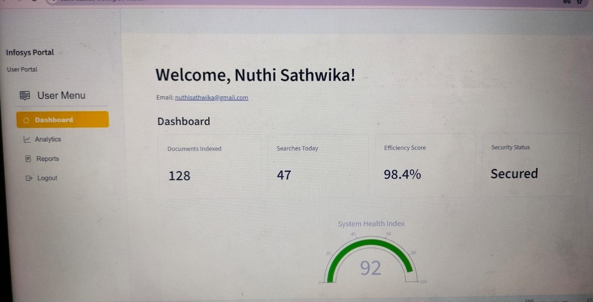

# Infosys Springboard Internship 7.0 – Milestone 1

## User Authentication Module (Streamlit + JWT + ngrok + Gmail OTP)

### Project Overview
This project implements a secure, production-ready User Authentication Module using Python and Streamlit as part of the Infosys Springboard Internship 7.0 Milestone 1. It serves as the foundation for secure application access, integrating modern UI design, robust security practices, and reliable recovery workflows.

---

### Features Built
1. **User Sign Up**:
   - Mandatory field validation across all required inputs.
   - Strict email format validation ensuring correct structure (`ab@cd.ef` shape).
   - Comprehensive password complexity rules (minimum 8 characters, uppercase, lowercase, numbers, and special symbols).
   - Security question selection and securely hashed answers for account recovery.
   - Unique username and email enforcement to prevent duplicate registrations.

2. **User Login**:
   - Credential verification backed by `bcrypt` password hashing.
   - Generic error messages on failure to prevent username enumeration security risks.
   - Generates a cryptographically signed JSON Web Token (JWT) session upon successful authentication.

3. **Forgot Password Flow**:
   - **Security Question Route**: Validates user identity via pre-configured security answers[cite: 1].
   - **Gmail OTP Route**: Generates a 6-digit one-time code, signs it into a short-lived JWT token (5-minute expiry)[cite: 2], and delivers it via Gmail SMTP with modern HTML templates[cite: 2].

4. **User & Admin Dashboards**:
   - **User Dashboard**: Protected by JWT validation[cite: 1]; features custom analytics metrics, system health indicators, and a profile editing page.
   - **Admin Dashboard**: Accessible through a separate administrative login[cite: 1]; displays an overview table of all registered users without exposing sensitive password hash data[cite: 1].

5. **Public Tunneling**:
   - Powered by `pyngrok` to securely expose the Google Colab-hosted Streamlit application via a public HTTPS URL.

---

### Tech Stack
- **Frontend / UI**: Streamlit, Plotly
- **Security & Cryptography**: PyJWT, bcrypt.
- **Database**: SQLite3.
- **Email Transfer**: Python `smtplib` + Gmail App Password.
- **Deployment Tunneling**: pyngrok.

---

### Project Structure
```text
Milestone1/
├── screenshots/
│   ├── Admin login.jpeg
│   ├── Admin dashboard.jpeg
│   ├── Create Account.jpeg
│   ├── User login.jpeg
│   ├── Reset Password.jpeg
│   ├── Reset Password by OTP.jpeg
│   └── Reset Password by Security Question.jpeg
├── README.md
└── app.ipynb
```
### Setup & Configuration via Colab Secrets
To run this application, store the following secrets securely in Google Colab's Secrets tab (🔑) with notebook access enabled:
- `JWT_SECRET`: Random secret signing key for session tokens.
- `NGROK_AUTHTOKEN`: Personal authtoken from your ngrok dashboard.
- `EMAIL_ADDRESS`: Gmail address used to dispatch OTP emails.
- `EMAIL_PASSWORD`: 16-character Gmail App Password.

### How to Run the Project
1. Open the project notebook in Google Colab.
2. Configure the required environment variables in the Colab Secrets panel.
3. Run the installation cell to install dependencies (`streamlit`, `pyjwt`, `bcrypt`, `pyngrok`, `plotly`, `streamlit-option-menu`).
4. Run the code cells sequentially to write `app.py` and start the server.
5. Access the application via the generated public ngrok URL.

### Screenshots
- **Admin Dashboard**: 
- **Admin Login**: 
- **Registered Users**: 
- **Create Account**: 
- **User Dashboard**: 
- **Reset Password**: 
- **Reset Password by OTP**: 
- **Reset Password by Security Question**: 

## Conclusion
This project successfully implements a secure User Authentication Module using Python, Streamlit, and SQLite. Styled in Infosys Corporate Blue (`#007cc3`), it features `bcrypt` password hashing, PyJWT session management, email sanitization, dual password recovery (Security Questions & Gmail OTP), profile editing, interactive Plotly metrics, and a dedicated admin portal—fully satisfying all requirements for Milestone 1 of the Infosys Springboard Internship 7.0.

