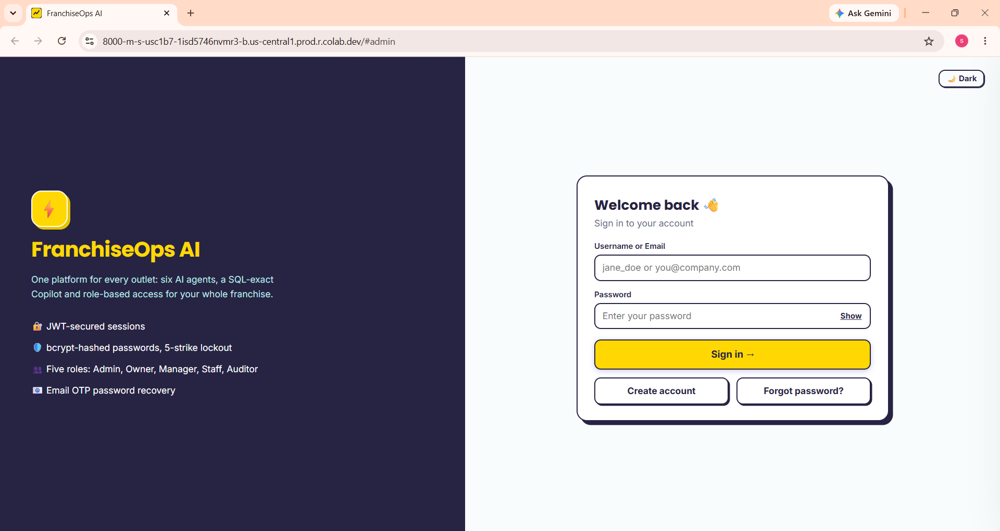
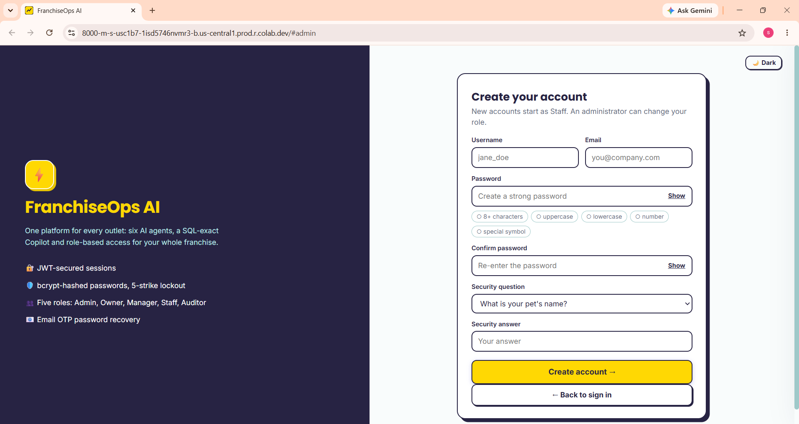
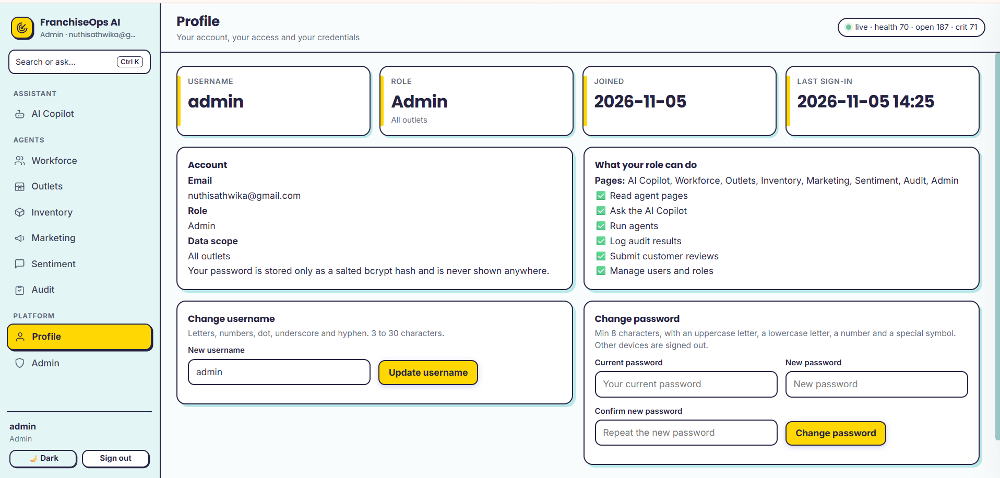
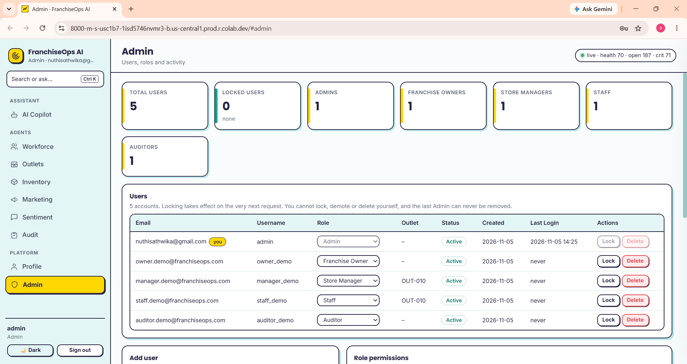
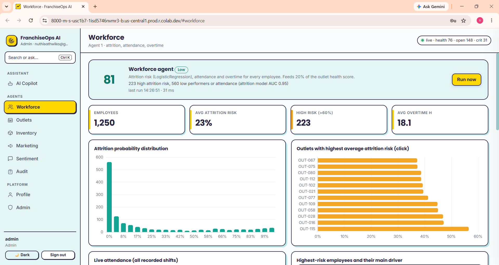
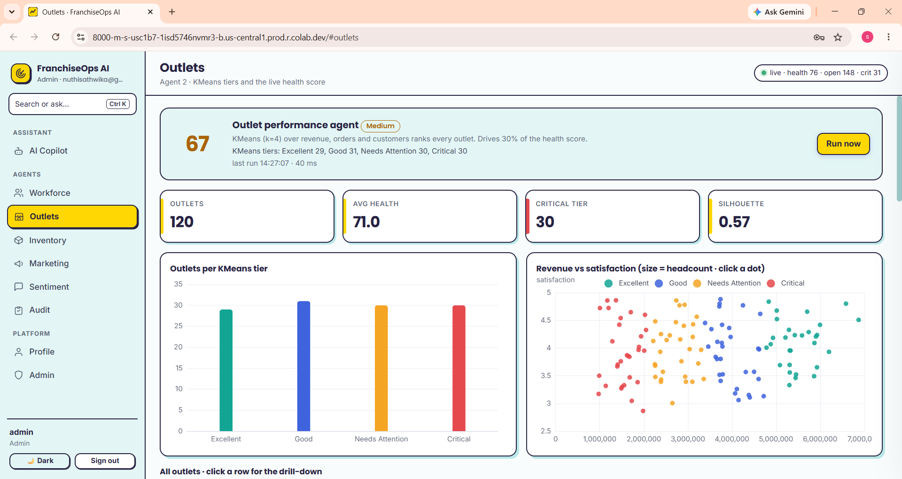
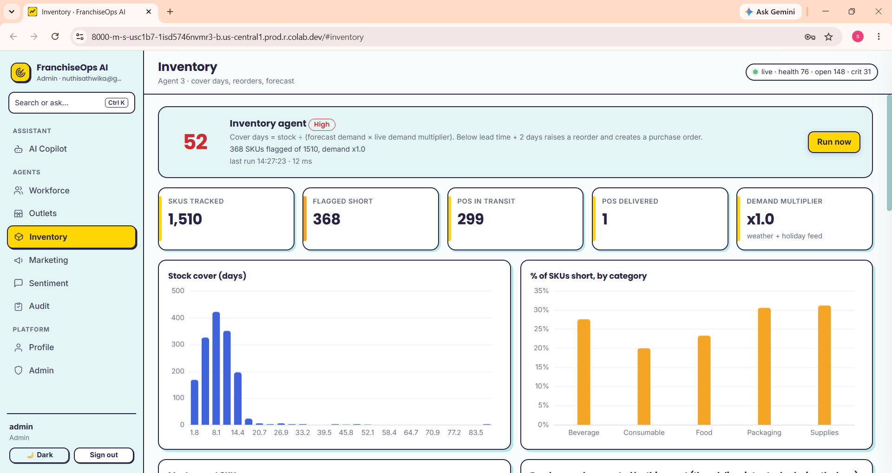
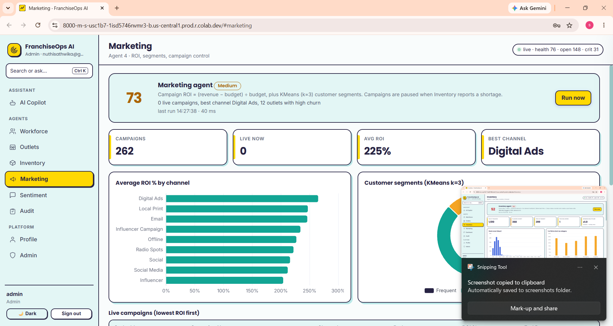
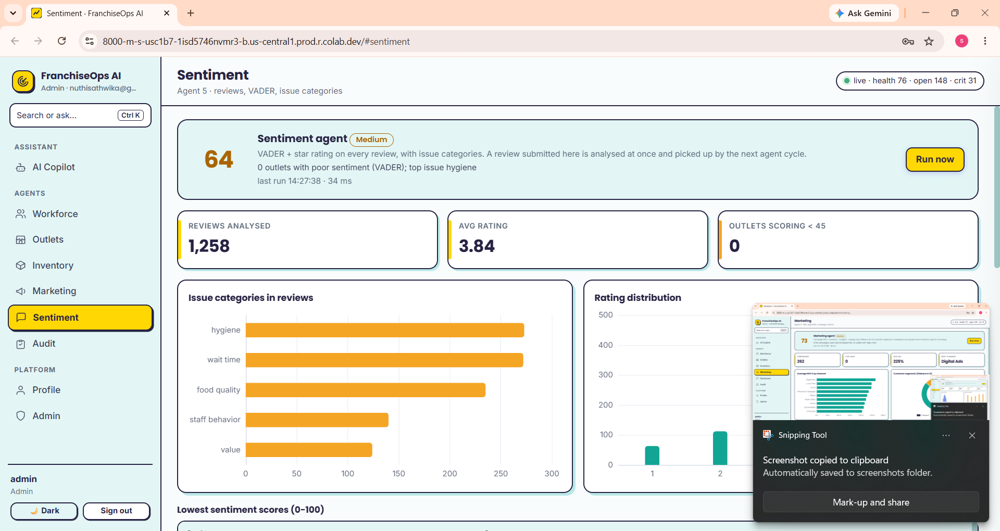
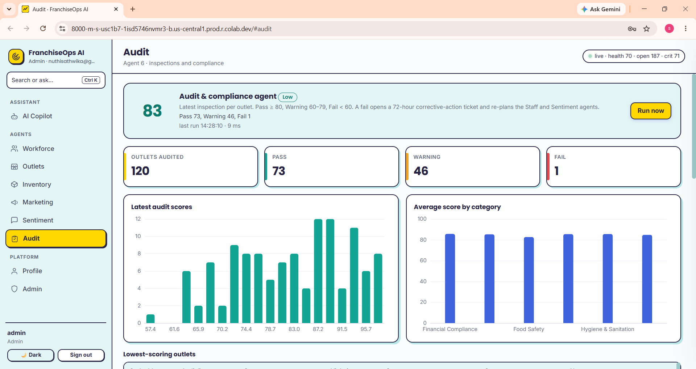

# FranchiseOps AI – AI-Powered Franchise Management Platform

**Infosys Springboard Internship 7.0 | Batch 4 | Milestone 2**

A multi-user franchise management platform built using **Python, FastAPI, SQLite, JWT Authentication, Role-Based Access Control (RBAC), and an SQL-based AI Copilot**.

---

## 1. Project Overview

FranchiseOps AI is a centralized franchise operations management platform designed to help businesses monitor and manage multiple franchise outlets through a single dashboard.

The application provides business analytics, workforce monitoring, inventory management, marketing performance analysis, customer sentiment analysis, compliance monitoring, and an interactive SQL-based AI Copilot.

This milestone extends the initial FranchiseOps application by integrating the secure authentication system developed in Milestone 1 and introducing multi-user access, role-based permissions, profile management, and an administrative dashboard.

### Main Objectives

- Integrate Milestone 1 authentication into the FranchiseOps application.
- Implement secure multi-user authentication using JWT.
- Create five user roles with different permissions.
- Implement server-side Role-Based Access Control.
- Develop an Admin dashboard for user management.
- Enhance the SQL-based AI Copilot.
- Improve the frontend design and user experience.
- Support automated agent execution through background workers.

---

## 2. Key Features

### A. Authentication and User Management

- User registration and login.
- Forgot-password functionality.
- Password hashing using Bcrypt.
- JWT-based authentication.
- Account locking after five unsuccessful login attempts.
- Username and password management.
- Profile page displaying user information.
- Last-login tracking.
- Email OTP and security-question-based password recovery.

### B. Role-Based Access Control (RBAC)

Five different user roles are implemented:

1. Admin
2. Franchise Owner
3. Store Manager
4. Staff
5. Auditor

Each role has specific page access and action permissions. Permissions are enforced on the backend, not just by hiding frontend menu items.

### C. Admin Dashboard

The Admin dashboard provides:

- User management table.
- Add new users.
- Delete users with confirmation.
- Promote or demote user roles.
- Lock and unlock user accounts.
- Total user count.
- Users grouped by role.
- Locked-user statistics.
- Admin activity log displaying the latest 50 records.
- Role permission matrix.

### D. SQL-Based AI Copilot

The application includes a database-grounded Copilot that understands greetings and business-related questions.

It uses intent recognition, question matching and whitelisted SQL queries to retrieve information from the database.

Supported business domains include:

- Outlets
- Workforce
- Inventory
- Marketing
- Customer sentiment
- Audits
- Tickets

The Copilot respects user permissions and outlet-level data restrictions.

**Note:** The Copilot is SQL-based. It does not use an LLM or RAG pipeline for answering business questions.

### E. Six Business Agents

| Agent | Functionality |
|---|---|
| Workforce Agent | Workforce monitoring, staffing analysis and attrition prediction. |
| Outlets Agent | Outlet health scoring and outlet performance ranking. |
| Inventory Agent | Stock monitoring, demand forecasting and reorder tickets. |
| Marketing Agent | Campaign performance, ROI calculation and customer segmentation. |
| Sentiment Agent | Customer feedback sentiment analysis and issue categorization. |
| Audit Agent | Compliance monitoring, audit scoring and identification of findings. |

Agents execute through the background runtime and record their actions as tickets.

---

## 3. Technology Stack

### Backend Technologies

| Technology | Purpose |
|---|---|
| Python | Core programming language. |
| FastAPI | Backend framework for creating REST APIs. |
| Uvicorn | ASGI server used to run FastAPI. |
| SQLite | Database for storing application and business data. |
| Pandas | Data manipulation and analysis. |
| NumPy | Numerical computations. |
| Scikit-learn | Machine learning algorithms and predictive analysis. |
| SciPy | Scientific and mathematical operations. |
| LangGraph | Agent workflow orchestration. |
| Bcrypt | Secure password hashing. |
| PyJWT | JWT creation and verification. |
| Requests | External API communication. |
| VADER Sentiment | Customer feedback sentiment analysis. |
| PDFPlumber | PDF text extraction. |
| Pyngrok | Alternative public access to the application. |

### Frontend Technologies

| Technology | Purpose |
|---|---|
| HTML5 | Webpage structure. |
| CSS3 | Styling and responsive layouts. |
| JavaScript | Frontend functionality and API integration. |
| Apache ECharts | Interactive charts and visualizations. |
| Leaflet | Interactive maps. |
| TopoJSON | Geographic data representation. |
| Inter / Poppins | Frontend typography. |

### Development Environment

- Google Colab
- Python
- Git and GitHub
- Google Colab Secrets
- ngrok (fallback access)

---

## 4. Project Architecture

The application follows a frontend-backend architecture.

```text
                 USER
                   |
                   v
          FRONTEND APPLICATION
          HTML + CSS + JavaScript
                   |
                   v
             FASTAPI SERVER
               server.py
                   |
          +--------+---------+
          |        |         |
          v        v         v
       auth.py   rbac.py    Copilot
          |        |       analyst.py
          |        |        qa.py
          |        |        |
          +--------+--------+
                   |
                   v
              db.py
                   |
                   v
             SQLITE DATABASE
                   |
                   v
          BUSINESS OPERATIONS
          domain_franchise.py
                   |
                   v
             LIVE ENGINE
             live_engine.py
                   |
                   v
           BACKGROUND WORKER
               worker.py
                   |
                   v
           AGENT EXECUTION
          Workforce / Outlets
          Inventory / Marketing
          Sentiment / Audit
```

### Application Workflow

1. The user opens the application through the browser.
2. The frontend communicates with the FastAPI backend.
3. The authentication module verifies the user's credentials.
4. JWT tokens are used to authenticate subsequent requests.
5. RBAC checks the user's role and permissions.
6. The backend retrieves information from SQLite.
7. Business logic and agents process the requested operations.
8. Results are returned to the frontend as JSON responses.
9. JavaScript displays the information through tables, charts and dashboard components.

---

## 5. Project Directory Structure

The notebook generates the following application structure:

```text
Milestone2/
│
├── Milestone2_FranchiseOps_FastAPI.ipynb
├── README.md
│
├── Screenshots/
│   ├── login.png
│   ├── signup.png
│   ├── profile.png
│   ├── admin_dashboard.png
│   ├── role_access_denied.png
│   ├── copilot.png
│   ├── workforce.png
│   ├── outlets.png
│   ├── inventory.png
│   ├── marketing.png
│   ├── sentiment.png
│   └── audit.png
│
└── app/                       # Generated during notebook execution
    │
    ├── server.py
    ├── auth.py
    ├── rbac.py
    ├── db.py
    ├── config.py
    │
    ├── analyst.py
    ├── qa.py
    ├── intent_router.py
    ├── copilot_ext.py
    │
    ├── domain_franchise.py
    ├── live_engine.py
    ├── worker.py
    │
    ├── views_core.py
    ├── views_franchise.py
    ├── views_platform.py
    ├── blocks.py
    │
    ├── entities.py
    ├── alts.py
    ├── seed_data.py
    ├── scale_data.py
    │
    ├── hardening.py
    ├── mailer.py
    ├── gpu.py
    ├── seanav.py
    ├── weather.py
    ├── weather_context.py
    │
    └── static/
        ├── index.html
        ├── style.css
        ├── app.js
        └── vendor/
```

### Important Backend Files

| File | Responsibility |
|---|---|
| server.py | Main FastAPI application, API routes and request handling. |
| auth.py | Registration, login, JWT authentication and password recovery. |
| rbac.py | Role definitions, page permissions and capabilities. |
| db.py | SQLite database connections and chat-history operations. |
| config.py | Application settings, database paths and secrets configuration. |
| analyst.py | Business question analysis and analytical responses. |
| qa.py | SQL-based question answering and database query generation. |
| intent_router.py | Identifies question intent and routes it to appropriate processing logic. |
| copilot_ext.py | Additional Copilot question-handling functionality. |
| domain_franchise.py | Franchise business logic and agent implementations. |
| live_engine.py | Agent execution, runtime management and background workflows. |
| worker.py | Runs the background processing runtime. |
| blocks.py | Reusable dashboard components, KPIs, charts and tables. |
| views_core.py | Common dashboard page construction. |
| views_franchise.py | Franchise-specific dashboard pages. |
| views_platform.py | Platform-level pages and profile/admin interfaces. |
| seed_data.py | Creates and initializes sample business data. |
| scale_data.py | Generates additional sample franchise data. |
| entities.py | Retrieves business entity details. |
| alts.py | Provides alternative calculations and recommendations. |
| hardening.py | Security middleware, request protection and error handling. |
| mailer.py | Email delivery for OTPs and notifications. |
| gpu.py | GPU status utility. |
| seanav.py | Sea-navigation calculations. |
| weather.py | Weather data integration. |
| weather_context.py | Weather-related location context. |

### Frontend Files

| File | Responsibility |
|---|---|
| index.html | Main webpage structure and frontend resource loading. |
| style.css | Layout, typography, themes, colors and responsive design. |
| app.js | Navigation, API communication, authentication handling and dashboard interactions. |
| vendor/ | Bundled third-party frontend libraries for charts, maps and fonts. |

---

## 6. Role-Based Access Control (RBAC)

RBAC controls which pages and actions each user can access.

The implementation uses two main dictionaries in `rbac.py`:

- `ROLE_MENU`: Defines which pages each role can access.
- `ROLE_CAPS`: Defines which actions each role can perform.

### Role Descriptions

| Role | Description |
|---|---|
| Admin | Platform administrator with complete access and user-management privileges. |
| Franchise Owner | Manages multiple outlets and can access and run all six agents. |
| Store Manager | Manages one assigned outlet and can access permitted operational pages. |
| Staff | Outlet employee with access to the Copilot and Profile. |
| Auditor | Compliance reviewer with read-only access to business pages. |

### Permission Matrix

Based on the actual RBAC implementation:

| Role | Copilot | Workforce | Outlets | Inventory | Marketing | Sentiment | Audit | Run Agents | Manage Users |
|---|---|---|---|---|---|---|---|---|---|
| Admin | ✓ | ✓ | ✓ | ✓ | ✓ | ✓ | ✓ | ✓ | ✓ |
| Franchise Owner | ✓ | ✓ | ✓ | ✓ | ✓ | ✓ | ✓ | ✓ | ✗ |
| Store Manager | ✓ | ✓ | ✓ | ✓ | ✗ | ✓ | ✓ | ✗ | ✗ |
| Staff | ✓ | ✗ | ✗ | ✗ | ✗ | ✗ | ✗ | ✗ | ✗ |
| Auditor | ✓ | ✓ | ✓ | ✓ | ✓ | ✓ | ✓ | ✗ | ✗ |

**Additional permissions:**

- Profile access is available to all five roles.
- Store Managers and Staff have outlet-level data scoping.
- Store Managers cannot access Marketing.
- Staff can ask permitted Copilot questions about their own outlet.
- Auditors cannot run agents or perform modification actions.
- Only Admin can manage users and roles.

### Server-Side Permission Enforcement

The backend uses:

- `menu_for()` to determine visible pages.
- `need(ctx, capability)` to verify action permissions.
- `ctx()` to construct the current user's context and outlet scope.
- `user_of(request)` to identify and authenticate the current user.

Unauthorized requests return HTTP 403 Forbidden.

---

## 7. Authentication and Security

The application integrates the Milestone 1 authentication functionality.

### Authentication Flow

```text
User Registration
       |
       v
Email and Password Validation
       |
       v
Bcrypt Password Hashing
       |
       v
SQLite Users Table
       |
       v
User Login
       |
       v
Credential Verification
       |
       v
JWT Token Generation
       |
       v
Authorization: Bearer <token>
       |
       v
Backend Authentication
       |
       v
RBAC Permission Verification
       |
       v
Protected Application Access
```

### Security Features

| Feature | Implementation |
|---|---|
| Password security | Bcrypt hashing. |
| Authentication | JWT tokens. |
| Token algorithm | HS256. |
| Token expiry | 2 hours. |
| Account protection | Automatic lock after 5 incorrect passwords. |
| Password validation | Minimum 8 characters, uppercase, lowercase, number and special symbol. |
| Email validation | Minimum two letters before @, between @ and the final dot, and after the final dot. |
| Account management | Admin lock and unlock functionality. |
| Immediate access revocation | User and token-version verification on every request. |
| Password recovery | Email OTP or security-question verification. |
| Activity tracking | Admin activity log. |

The password hash is never displayed in the frontend.

### Important Database Tables

The application uses SQLite for persistent application storage.

The authentication module creates and manages:

- `users` – User information, roles, password hashes and account status.
- `password_resets` – Password recovery OTP information.
- `admin_log` – Administrative activity records.

The business database also contains operational tables for outlets, workforce, inventory, sales, marketing, customer feedback, audits and other business information.

---

## 8. AI Copilot – SQL-Based Question Answering

The Copilot provides answers to business-related questions using database information.

### Working Components

| Component | Purpose |
|---|---|
| analyst.py | Business-specific question analysis. |
| qa.py | Matches questions with database tables and columns and builds SQL queries. |
| intent_router.py | Classifies and routes user questions. |
| copilot_ext.py | Provides additional Copilot processing. |
| db.py | Supports database connectivity. |
| server.py | Exposes the Copilot API endpoint. |

### Copilot Execution Flow

1. User enters a question.
2. The system checks for greetings and supported question patterns.
3. The intent-processing logic identifies the relevant business domain.
4. The SQL query logic retrieves matching database records.
5. Outlet-level and role-based restrictions are applied.
6. The answer and supporting query information are returned.
7. The frontend displays the response.

### Example Questions to Test

| Business Domain | Example Question |
|---|---|
| Outlets | Which outlet has the lowest CSAT? |
| Workforce | How many staff members work at OUT-010? |
| Inventory | List items below their reorder level. |
| Marketing | Which campaign has the highest ROI? |
| Sentiment | Show negative customer reviews. |
| Audit | Which outlets have failed audits? |
| Sales | Show the total sales for an outlet. |
| Greetings | Hello, how can you help me? |

**Important:** These are example test prompts, not a claim that every question has already been individually tested. Add actual answers, generated SQL and row counts after running your Copilot.

### Copilot Testing Record

| Question | Expected Data Domain | Actual Answer / SQL | Status |
|---|---|---|---|
| Which outlet has the lowest CSAT? | Outlets / Sentiment | Add actual result | Pending verification |
| How many staff work at OUT-010? | Workforce | Add actual result | Pending verification |
| List items below reorder level. | Inventory | Add actual result | Pending verification |
| Which campaign has the highest ROI? | Marketing | Add actual result | Pending verification |
| Show negative customer reviews. | Sentiment | Add actual result | Pending verification |

The Copilot must return database-grounded information rather than inventing business figures.

---

## 9. Business Agent Architecture

The application contains six main operational agent pages.

| Agent | Main Operations | Related Techniques |
|---|---|---|
| Workforce | Employee monitoring and attrition analysis. | Logistic Regression and feature preprocessing. |
| Outlets | Outlet health scoring and ranking. | K-Means clustering and StandardScaler. |
| Inventory | Demand analysis and stock-reorder monitoring. | Forecast-based calculations and inventory rules. |
| Marketing | Campaign ROI and customer segmentation. | ROI calculations and K-Means clustering. |
| Sentiment | Customer feedback classification. | VADER sentiment analysis and fallback lexicon. |
| Audit | Compliance scoring and findings. | Rule-based score classification and SOP hints. |

### Agent Execution

The background processing architecture consists of:

- `domain_franchise.py` – Contains franchise agent implementations.
- `live_engine.py` – Coordinates agent execution and runtime workflows.
- `worker.py` – Runs background processing separately from the web server.

The system also supports periodic processing and manual agent execution through backend endpoints.

---

## 10. Admin Dashboard

The Admin dashboard is restricted to the Admin role.

### Functionalities

1. View registered users.
2. Add users with assigned roles.
3. Delete users with confirmation.
4. Promote or demote users.
5. Lock or unlock accounts.
6. View user account status.
7. Monitor user statistics.
8. View administrative activity logs.
9. View the role permission matrix.

### Administrative Protections

- An administrator cannot lock or delete their own account.
- The last remaining Admin cannot be removed.
- Locked users cannot continue using existing sessions.
- All user-management routes require the `users` capability.

---

## 11. API Endpoints

The application exposes REST API endpoints through FastAPI.

### Authentication APIs

| Method | Endpoint | Purpose |
|---|---|---|
| GET | `/api/public` | Public application information. |
| GET | `/api/me` | Retrieves current user information. |
| POST | `/api/auth/signup` | Registers a new user. |
| POST | `/api/auth/login` | Authenticates a user. |
| POST | `/api/auth/forgot` | Starts password recovery. |
| POST | `/api/auth/reset` | Resets a password. |

### Profile APIs

| Method | Endpoint | Purpose |
|---|---|---|
| GET | `/api/profile` | Retrieves profile information. |
| POST | `/api/profile/username` | Updates username. |
| POST | `/api/profile/password` | Changes password. |

### Admin APIs

| Method | Endpoint | Purpose |
|---|---|---|
| GET | `/api/admin/users` | Lists users and administrative statistics. |
| POST | `/api/admin/users` | Adds a new user. |
| DELETE | `/api/admin/users/{uid}` | Deletes a user. |
| POST | `/api/admin/users/{uid}/role` | Changes a user's role. |
| POST | `/api/admin/users/{uid}/lock` | Locks or unlocks a user. |

### Business and Copilot APIs

| Method | Endpoint | Purpose |
|---|---|---|
| GET | `/api/page/{id}` | Retrieves dashboard page data. |
| GET | `/api/detail/{id}` | Retrieves entity details. |
| POST | `/api/copilot` | Processes Copilot questions. |
| POST | `/api/run_cycle` | Runs an agent cycle. |
| POST | `/api/run_agent` | Runs a selected agent. |
| GET | `/api/pulse` | Retrieves runtime status. |
| GET | `/api/stream` | Streams application updates. |
| GET | `/api/health` | Checks application health. |

Additional routes support franchise reviews, audits, chat history and weather refresh functionality.

---

## 12. Database and Data Management

SQLite is used as the primary database.

The application initializes its database and supporting tables through its backend modules.

### Database Responsibilities

- Store registered users and authentication information.
- Store franchise outlet information.
- Maintain workforce and employee records.
- Store inventory and reorder information.
- Maintain sales and marketing records.
- Store customer feedback.
- Maintain audit records and tickets.
- Store application activity and chat history.

### Sample Data

The notebook includes:

- `seed_data.py` for initializing sample data.
- `scale_data.py` for generating additional business data.

The application stores runtime data separately from the notebook's source-code directory.

The default Colab data directory is:

```text
/content/app_data/
```

The primary Franchise database is:

```text
franchise_database.db
```

For persistent use, configure a suitable storage location through `PERSIST_DIR` or another supported application data-directory setting.

---

## 13. Installation and Execution

### Environment

The project is designed to run in Google Colab.

### Step 1: Clone or Download the Repository

Download the repository containing the Milestone2 folder.

### Step 2: Open the Notebook

Open:

```text
Milestone2_FranchiseOps_FastAPI.ipynb
```

in Google Colab.

### Step 3: Configure Colab Secrets

Open the Secrets section using the key icon in the left sidebar.

Configure:

| Secret | Required | Purpose |
|---|---|---|
| JWT_SECRET | Yes | JWT signing secret required by the notebook launcher. |
| NGROK_AUTHTOKEN | Optional | Fallback public application URL. |
| EMAIL_ADDRESS | Optional | Email sender for OTP recovery. |
| EMAIL_PASSWORD | Optional | Gmail application password. |
| ADMIN_EMAIL | Optional | Initial administrator email. |
| ADMIN_PASSWORD | Optional | Initial administrator password. |
| DEMO_PASSWORD | Optional | Password for generated demonstration accounts. |

Enable Notebook access for the required secrets.

**Never hardcode passwords, API keys or authentication tokens inside notebook cells or GitHub files.**

### Step 4: Run the Notebook

Select:

```text
Runtime → Run all
```

The notebook performs the following operations:

1. Installs required Python packages.
2. Creates the application directories.
3. Generates backend Python files.
4. Creates frontend HTML, CSS and JavaScript files.
5. Extracts bundled frontend resources.
6. Loads environment secrets.
7. Configures the initial Admin account.
8. Starts the FastAPI server using Uvicorn.
9. Generates the application access link.

### Step 5: Open the Application

Wait until the notebook displays:

```text
FranchiseOps AI is running
```

Click the generated **Open the app** link.

If the Colab proxy is unavailable, configure `NGROK_AUTHTOKEN` and execute the final access-link cell again.

### Step 6: Test User Roles

The optional final notebook cell creates demonstration accounts for:

- Franchise Owner
- Store Manager
- Staff
- Auditor

The password is generated or retrieved from the configured `DEMO_PASSWORD` secret and displayed during execution.

Use separate accounts to test the permissions of each role.

---

## 14. Screenshots

Add actual application screenshots to the `Screenshots/` folder.

### Authentication

**Login Page**



**Signup Page**



### User Profile



### Admin Dashboard



### Role-Based Access Control


### AI Copilot


### Agent Dashboards

**Workforce Agent**



**Outlets Agent**



**Inventory Agent**



**Marketing Agent**



**Sentiment Agent**



**Audit Agent**



---

## 15. Security Considerations

- Passwords are stored as Bcrypt hashes.
- JWT secrets are loaded through environment variables and Colab Secrets.
- API endpoints require authentication where appropriate.
- Server-side RBAC prevents unauthorized page and action access.
- Store Managers and Staff have outlet-level data restrictions.
- User account status is checked during authentication.
- Account lockout is implemented after repeated unsuccessful login attempts.
- Administrative actions are recorded.
- Sensitive information is not displayed in the Admin dashboard.

**Repository safety:** Do not upload database files, password files, JWT secrets, ngrok tokens, email credentials or notebook outputs containing sensitive information.

---

## 16. Testing and Validation

The following tests should be performed before final submission.

| Test Case | Expected Result |
|---|---|
| User signup with valid details | Account created successfully. |
| Signup with invalid email | Validation error displayed. |
| Signup with weak password | Password validation error. |
| Login with correct credentials | JWT generated and dashboard opened. |
| Login with incorrect password | Generic invalid-credentials error. |
| Five unsuccessful login attempts | Account locked. |
| Update username | Profile updated. |
| Change password | New password saved securely. |
| Staff accessing Workforce | HTTP 403 Forbidden. |
| Store Manager accessing Marketing | HTTP 403 Forbidden. |
| Auditor attempting to run agents | HTTP 403 Forbidden. |
| Franchise Owner accessing Admin | HTTP 403 Forbidden. |
| Admin managing users | Access permitted. |
| Locked user using an existing token | Access denied. |
| Copilot asking a supported question | Database-grounded answer returned. |
| Manual agent execution | Agent cycle executed for permitted roles. |

Update this table with your actual test results after verification.

---

## 17. Project Learning Outcomes

Through this milestone, the following technical concepts and practical skills are demonstrated:

- Building backend applications using FastAPI.
- Understanding REST API architecture.
- Integrating frontend and backend applications.
- Working with SQLite databases.
- Implementing JWT authentication.
- Understanding secure password hashing.
- Implementing Role-Based Access Control.
- Designing multi-user applications.
- Building administrative dashboards.
- Working with SQL-based question answering.
- Applying machine learning algorithms to business operations.
- Developing background processing workflows.
- Working with interactive data visualizations.
- Managing application secrets securely.
- Deploying applications through Google Colab and ngrok.

---

## 18. Future Enhancements

Potential improvements for future versions include:

- Integrating an LLM-powered Copilot.
- Implementing Retrieval-Augmented Generation (RAG) for business documents and SOPs.
- Adding natural-language-to-SQL capabilities with stricter query validation.
- Integrating LangGraph-based multi-agent collaboration.
- Adding predictive analytics for sales and demand forecasting.
- Implementing advanced business forecasting.
- Deploying the application on a cloud platform.
- Migrating SQLite to PostgreSQL for production-scale usage.
- Adding automated unit and integration tests.
- Implementing comprehensive audit and monitoring dashboards.

---

## 19. Project Information

| Field | Details |
|---|---|
| Project Name | FranchiseOps AI |
| Internship | Infosys Springboard Internship 7.0 |
| Batch | Batch 4 |
| Milestone | Milestone 2 |
| Application Type | Full-Stack Franchise Management Platform |
| Backend | Python, FastAPI |
| Database | SQLite |
| Authentication | JWT and Bcrypt |
| Authorization | Role-Based Access Control |
| Frontend | HTML, CSS, JavaScript |
| Development Environment | Google Colab |
| Deployment Access | Colab Proxy / ngrok |

---

## 20. Acknowledgement

Developed as part of **Infosys Springboard Internship 7.0 – Batch 4, Milestone 2**.

This milestone builds upon the provided FranchiseOps AI reference application and integrates the authentication and user-management functionality from Milestone 1.

The project demonstrates practical implementation of backend development, database management, secure authentication, access control, business analytics and agent-based workflows.

---

**FranchiseOps AI – Bringing franchise operations, business intelligence and intelligent automation together.**
