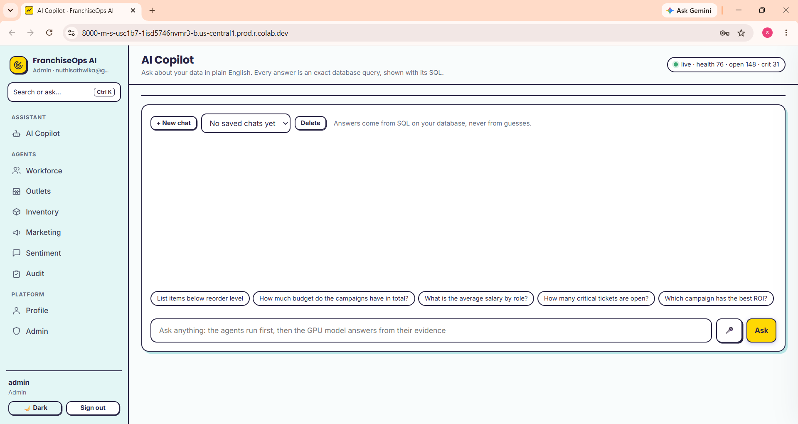

# FranchiseOps AI – Milestone 2

### Infosys Springboard Internship 7.0 | Batch 4

## 1. Project Overview

**FranchiseOps AI** is an AI-powered franchise management and performance monitoring system developed using Python and FastAPI.

The system helps franchise businesses monitor outlet performance, inventory, workforce, marketing campaigns, customer feedback, and audit activities.

Milestone 2 extends the existing platform with role-based access control (RBAC), an Admin Dashboard, franchise monitoring agents, and an SQL-powered AI Copilot that answers supported business questions using database records.

## 2. Project Objectives

- Monitor franchise outlet performance and business operations.
- Identify inventory shortages and workforce-related issues.
- Analyze sales, revenue, customer satisfaction, and marketing performance.
- Support audit monitoring and corrective actions.
- Provide secure, role-based access to platform features.
- Enable users to retrieve business information through the AI Copilot.

## 3. Technology Stack

| Category | Technologies |
|---|---|
| Programming Language | Python |
| Backend Framework | FastAPI |
| Database | SQLite |
| Authentication | JWT, bcrypt |
| Data Processing | Pandas, NumPy |
| Machine Learning | Scikit-learn, SciPy |
| Data Visualization | Matplotlib |
| Sentiment Analysis | VADER Sentiment |
| Document Processing | pdfplumber |
| API / Networking | Requests |
| Deployment | Google Colab, Uvicorn, ngrok |

## 4. Key Features – Milestone 2

- **Role-Based Access Control:** Provides permissions based on user roles.
- **Admin Dashboard:** Supports user management, role assignment, and account management.
- **Franchise Monitoring:** Monitors outlet performance, revenue, and customer satisfaction.
- **Inventory Management:** Identifies low-stock products and reorder requirements.
- **Workforce Monitoring:** Analyzes staff availability, overtime, salary, and attrition risk.
- **Marketing Analysis:** Evaluates campaign performance, budgets, and ROI.
- **Customer Feedback Analysis:** Analyzes ratings, reviews, and sentiment.
- **Audit Monitoring:** Identifies failed audits and tracks audit-related information.
- **AI Copilot:** Answers 25 supported business questions and displays relevant database results in tabular form.

## 5. User Roles and Permissions

The application supports five user roles:

| Role | Permissions |
|---|---|
| Admin | Full platform access, user management, and all Copilot domains |
| Franchise Owner | Franchise monitoring, agent operations, and Copilot |
| Store Manager | Outlet-level workforce, inventory, sentiment, audit, and Copilot access |
| Staff | Limited outlet, inventory, and sentiment information |
| Auditor | Read-only monitoring across franchise data and Copilot |

Permissions are enforced on the server according to the user's role and permitted outlet scope.

## 6. AI Copilot – 25 Supported Questions

The AI Copilot uses question-intent recognition, predefined SQL handlers, spelling correction, and database queries to answer supported business questions.

### Supported Questions and Expected Results

| No. | Question | Expected Result |
|---:|---|---|
| 1 | Which outlet has the lowest CSAT? | Outlet, location, CSAT, revenue |
| 2 | Which outlet has the highest customer satisfaction? | Outlet, location, CSAT, revenue |
| 3 | What are the top 5 outlets by revenue? | Outlet and revenue ranking |
| 4 | Which outlets earn the lowest revenue? | Outlet and revenue |
| 5 | What is the total revenue? | Outlet count, total and average revenue |
| 6 | How many outlets do we have? | Total outlets and cities |
| 7 | How many staff does OUT-010 have? | Staff count by role |
| 8 | List items below the reorder level. | Item, category, stock, reorder level |
| 9 | Show the inventory summary by category. | Category, item count, below-reorder count |
| 10 | How many purchase orders are in transit? | Order status, purchase orders, units |
| 11 | Which campaign has the best ROI? | Campaign, channel, budget, ROI |
| 12 | Which campaign has the worst ROI? | Campaign, channel, budget, ROI |
| 13 | Which marketing channel performs best? | Channel, campaigns, average ROI |
| 14 | What is the total budget of all campaigns? | Channel, campaign count, total budget |
| 15 | Show negative reviews this week. | Outlet, rating, comment, date |
| 16 | What is the average customer rating? | Review count, average rating, sentiment |
| 17 | Which employees are most likely to quit? | Employee, role, attrition probability |
| 18 | What is the average salary by role? | Role, staff count, average salary |
| 19 | Which outlet has the most overtime? | Outlet, staff, average overtime |
| 20 | Which outlets have the most staff absences? | Outlet and absence count |
| 21 | Which outlets failed their audit? | Outlet, audit date, score, violations |
| 22 | Which outlet has the lowest audit score? | Outlet, audit score, violations, status |
| 23 | How many critical tickets are open? | Ticket ID, severity, type, details |
| 24 | What are today's sales? | Sales records, total amount, transactions |
| 25 | Tell me about OUT-005. | Outlet details, revenue, costs, CSAT, headcount |

### AI Copilot Capabilities

- Recognizes supported business question patterns.
- Handles spelling corrections and common synonyms.
- Executes predefined, read-only, parameterized SQL queries.
- Displays relevant results in tabular form.
- Provides a natural-language answer and the SQL query used.
- Applies role-based access restrictions to retrieved data.

## 7. Franchise Monitoring and Agent Operations

The system includes franchise-related monitoring and analytical operations for:

- Outlet performance and risk analysis.
- Inventory monitoring and stock shortage identification.
- Workforce and staff analysis.
- Marketing campaign performance.
- Customer feedback and sentiment analysis.
- Audit monitoring and violation tracking.
- Business performance summaries and anomaly identification.

## 8. Database and Security

- SQLite is used for application and franchise data storage.
- JWT is used for authenticated sessions.
- Passwords are securely hashed using bcrypt.
- User roles and outlet permissions are checked on every request.
- The Copilot uses read-only, parameterized SQL queries.
- Accounts are locked after five unsuccessful login attempts.
- Password recovery supports email OTP and security-question verification.

## 9. Main Application Modules

| Module | Responsibility |
|---|---|
| `server.py` | FastAPI application and API routes |
| `auth.py` | Authentication and session management |
| `rbac.py` | Role-based access control |
| `db.py` | Database operations |
| `copilot_ext.py` | AI Copilot question handling |
| `analyst.py` | Business question analysis |
| `qa.py` | Query and result handling |
| `domain_franchise.py` | Franchise monitoring and agent operations |
| `intent_router.py` | Business query intent classification |
| `seed_data.py` | Initial database data |
| `worker.py` | Background processing |

## 10. Screenshots

The following screenshots demonstrate the major features and interfaces of FranchiseOps AI.

### Authentication

| Login Page | Signup Page |
|---|---|
|  |  |

### User and Admin Management

| User Profile | Admin Dashboard |
|---|---|
|  |  |

### AI Copilot

### Franchise Monitoring Modules

| Workforce | Outlets |
|---|---|
|  |  |

| Inventory | Marketing |
|---|---|
|  |  |

| Customer Sentiment | Audit |
|---|---|
|  |  |

## 11. Execution Requirements

The project is configured to run in Google Colab.

### Execution Steps

1. Open the Milestone 2 notebook in Google Colab.
2. Add the required secrets in Google Colab Secrets.
3. Enable Notebook access for the required secrets.
4. Run all notebook cells from top to bottom.
5. Install the required Python packages.
6. Initialize the application and database.
7. Start the FastAPI server using Uvicorn.
8. Access the running application through the generated ngrok link.

### Required Secrets

| Secret | Purpose |
|---|---|
| `JWT_SECRET` | Required for signing authentication tokens |
| `NGROK_AUTHTOKEN` | ngrok authentication token for public access |
| `EMAIL_ADDRESS` | Sender email for OTP |
| `EMAIL_PASSWORD` | Gmail App Password for OTP |
| `ADMIN_EMAIL` | Optional initial Admin email |
| `ADMIN_PASSWORD` | Optional initial Admin password |

**Security Note:** Never upload passwords, API tokens, or credentials to GitHub. Store them securely in Google Colab Secrets.

## 12. Expected Outcome

FranchiseOps AI provides a centralized platform for franchise performance monitoring, business analysis, role-based operations, and AI-assisted decision support.

The AI Copilot allows authorized users to ask 25 supported business questions and retrieve relevant information through structured database results.

## 13. Team Contributions

| S. No. | Team Member | Individual Contribution |
|---:|---|---|
| 1 | Palak Agarwal | Login and Security |
| 2 | Mrunali Karmore | Role-Based Access Control (RBAC), Profile Management and Admin Dashboard |
| 3 | Nuthi Sathwika | AI Copilot and SQL Integration |
| 4 | Aditya | UI/UX Design, Agents and Project Submission |

